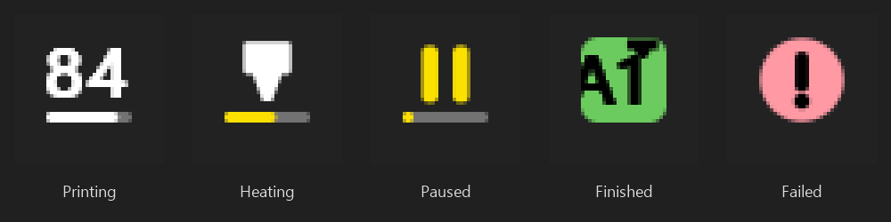

# Traycer



Glance at the tray to see how your 3D prints are going, and whether anything has finished.

Traycer is a WinUI 3 app that lives in the Windows notification area. It watches the printers on your network and draws the state of the most pressing one right on its tray icon: the percentage of the print that will finish first, a hotend while the heaters warm up for one, pause bars when a print is waiting, a green tile with the printer's name scrolling across it when a print is done and waiting for you, and a red mark when something failed. Click the icon for a card per printer.

## Supported printers

Traycer talks to each printer the way its own software does, on your local network. No cloud accounts.

| Type | Covers | What you enter |
|---|---|---|
| **Bambu Lab** | X1, P1, A1 and H2 series | IP address, serial number, LAN access code |
| **Prusa (PrusaLink)** | Core One, MK4/MK4S, MK3.9, XL, MINI, MK3S with PrusaLink | IP address, user name (`maker`) and password, or an API key on older PrusaLink |
| **Klipper (Moonraker)** | Voron, RatRig, Sovol SV08, Elegoo Neptune 4, Qidi, rooted Creality K1/K2, anything running Mainsail or Fluidd | IP address (port 7125 by default), and an API key only if Moonraker requires one |
| **OctoPrint** | Any printer connected to OctoPrint or OctoPi | IP address, API key |
| **Creality** | K1, K1C, K1 Max, K2, Hi and Ender-3 V3 on stock firmware | IP address |
| **Elegoo** | Centauri Carbon, Saturn and Mars resin printers (SDCP) | IP address |
| **FlashForge** | Adventurer 5M, 5M Pro, AD5X, Creator 5 | IP address, serial number, check code |
| **FlashForge (older)** | Adventurer 3 and 4, Finder, Guider, Creator | IP address |
| **Duet (RepRapFirmware)** | Duet 2 and 3, standalone or with a Raspberry Pi | IP address, and a password if the board has one |
| **UltiMaker** | S3, S5, S7, Ultimaker 3 | IP address |
| **Repetier-Server** | Any printer connected to Repetier-Server | IP address (port 3344), API key, optional printer slug |

**Show what each printer knows.** Every printer reports something different, and the cards show only what it reports. A FlashForge on the old protocol gives a percentage and temperatures. A Klipper printer adds time left, layers, the slicer and a preview image. A Bambu adds its print stage ("Heating bed", "Filament ran out"), speed mode, the AMS filament and its color, and Wi-Fi signal. Nothing is shown as blank or zero because a printer doesn't have it.

## Features

- **Tray icon:** one icon for all your printers, most urgent first: a failed print or printer error (red !), a printer waiting on you (amber !), a finished print you haven't marked complete (a green tile with `Voron done` scrolling across it, naming every printer that's done), a paused print (pause bars over its progress), then the percentage of the print that will finish soonest. Before any print is under way, a hotend over an amber bar shows the heaters warming up, the bar filling as they near their targets. With nothing going on, it's the plain app icon. It follows the taskbar's light or dark theme and renders at your display's DPI.
- **A little motion:** at 125% display scale and up, the finished tile's text comes out from under a print head, like a belt printer laying it down. When you mark the last finished print complete, the tile slides out of the icon like a plate pulled from the printer.
- **Tooltip:** a line per printer that has news, like `P1S: Finished` or `Voron: 45% · 1h 20m left`.
- **Cards:** the flyout has a card per printer: name, state, job name, progress bar, time left and the clock time it should be done, layer, temperatures, the printer's own status message, and a preview image when the printer serves one. The preview builds up from the bottom as the print goes (by layer, when the printer reports layers), with the rest of the part ghosted above a line at the layer being printed. While it prints, a glowing nozzle rides the end of the progress bar.
- **Details:** click a card for everything the printer reports, grouped into temperatures (with targets, and an amber bar under each heater while it warms up), details (speed, filament, nozzle and so on) and the printer itself. Open its web interface (Mainsail, Fluidd, OctoPrint, PrusaLink, Duet Web Control), edit it or remove it.
- **Notifications:** a Windows notification when a print finishes, fails, pauses or needs you. One per printer, replaced rather than piled up, and cleared when you open the flyout. Each kind can be turned off in Settings.
- **Mark as complete:** a finished print keeps the tray icon green until you press **Mark as complete** on its card (or on its details page), so a print never sits forgotten on the plate. Pressing it scrapes the card clean and slides the part off the preview, leaving an empty plate. Starting the next print on that printer clears it too. It survives restarting the app and editing the printer.
- **Seen it:** opening the flyout counts as seeing failures and warnings, so the tray icon goes back to showing progress.
- **Find printers:** scans your network. Bambu Lab, Elegoo and FlashForge printers announce themselves; OctoPrint, Moonraker (with zeroconf) and UltiMaker printers are found over mDNS. Pick one and the form is filled in.
- **Add by address:** type an IP address or host name and press **Detect**: Traycer works out what's there and fills in the type, and the serial number for Bambu Lab and FlashForge. The form asks only for what that type needs, and **Test connection** says what the printer reports before you save.
- **Unreachable printers:** a card keeps its last reading for about 90 seconds while it reconnects, then says the printer is offline and when it will try again.
- **Settings** (in the flyout): start with Windows, how often to check a printing printer (5 seconds to a minute), and which notifications to show.
- **Tray menu:** right-click for Open, Refresh printers, Find printers, Add a printer, Settings and Exit.
- **Single instance:** launching the app again opens the running instance's flyout.

## Install

Traycer isn't in the Microsoft Store yet. Build it from source (below), or install an MSIX from the GitHub releases page when one is published; sideloaded MSIX packages need their signing certificate trusted first.

Requires Windows 10 1809 (build 17763) or later, or Windows 11, on x64 or ARM64.

Windows puts a new app's tray icon in the overflow (^). Since the icon is the point, drag it onto the taskbar, or turn Traycer on under Settings > Personalization > Taskbar > Other system tray icons.

## Setting up each printer

- **Bambu Lab:** on the printer, the access code is under Settings > Network (WLAN) and the serial number under Settings > Device. Recent firmware may refuse third-party connections until you turn on **LAN mode** or **Developer mode**; if Traycer says the printer rejected the access code or sent no report, check those first.
- **PrusaLink:** on the printer, Settings > Network > PrusaLink shows the user name (usually `maker`) and password. For an older PrusaLink that uses an API key, leave the user name empty and put the key in the password field.
- **Klipper:** most setups trust the local network and need no key. Enter the address of the printer; if Mainsail or Fluidd is on port 80 and Moonraker isn't on 7125, add the port (`192.168.1.40:80`).
- **OctoPrint:** in OctoPrint, Settings > Application Keys (or API) gives you a key.
- **FlashForge (5M family):** turn on LAN-only mode on the printer to see the check code under Settings > Network. **Find printers** fills in the serial number.
- **Repetier-Server:** the API key is under Global settings > Connectivity. Leave the slug empty to follow the server's first printer.

## Privacy and footprint

- **Local only.** Traycer talks only to the printers you add, on your network, plus UDP broadcasts and mDNS while **Find printers** runs. It has no account, no cloud service and no telemetry.
- **Secrets stay in Windows.** API keys, access codes, passwords and check codes are stored in Windows Credential Manager (PasswordVault), never in settings files or logs.
- **Certificates.** Printers that use TLS present certificates Windows can't verify (Bambu Lab's come from Bambu's own authority). Traycer accepts them for Bambu's MQTT connection, and for HTTPS only when the address is a private IP or a `.local`/`.lan` name.
- **Polling.** The tray icon is the reason Traycer keeps watching with no window open. A printing printer is checked every 15 seconds (configurable), an idle one once a minute, and an unreachable one backs off to every five minutes. Bambu, Creality and Elegoo printers keep a connection open while they print and drop it while idle, checking back every three minutes.
- **Memory.** The flyout is hidden when dismissed and closed a minute later, then the app returns its memory to Windows.
- **Animation.** The scrolling tray icon redraws about 18 times a second, only while a finished print waits to be marked complete, and holds still while your session is locked or the screen is off. Each frame is cut from text rendered once, so it costs well under 1% of one CPU core. Everything else that moves either lasts a fraction of a second or runs only while the flyout is open. With Windows' animation effects off (Settings > Accessibility > Visual effects), the tray shows a plain check mark instead of the scrolling tile, and nothing in the flyout moves.

## Build from source

Prerequisites: the [.NET 10 SDK](https://dotnet.microsoft.com/download), the winapp CLI (`winget install Microsoft.WinAppCli`), and Developer Mode on (Settings > System > For developers).

```powershell
winapp run                 # build, register with package identity, launch
winapp run --clean         # same, with first-run state (the flyout opens on launch)
dotnet test TrayCer.Tests  # protocol parsers, policies, icon drawing
```

The app has no keys of its own, so there's nothing to configure. Package identity is needed for settings storage, notifications and the startup task.

### No printer? Fake ones

`scripts/FakePrinters.cs` runs six fake printers on `127.0.0.1`, each partway through a scripted print (40 seconds of warming up, then a few minutes of printing): Bambu Lab (MQTT over TLS, with announcements on the network), Klipper, OctoPrint, Creality, Elegoo (WebSocket and UDP discovery) and FlashForge (HTTP and UDP discovery).

```powershell
dotnet run --file scripts/FakePrinters.cs
```

The addresses, serial numbers and codes are at the top of the file. Steer the scripted prints at `http://localhost:7999`: `/status`, `/reset?p=all`, `/pause?p=bambu`, `/finish?p=octoprint`, `/error?p=klipper`, `/cancel?p=elegoo`, `/idle?p=creality`.

### Releases

`build-msix-for-gh.ps1` builds signed x64 and ARM64 MSIX packages and drafts a GitHub release.

## Project layout

| Path | What it holds |
|---|---|
| `App.xaml.cs` | Tray icon and menu, notifications, single instance, crash log (`%TEMP%\TrayCer-crash.log`) |
| `Views/` | The flyout window and its pages: printer list, printer card, details, add/edit, find printers, settings |
| `Services/PrinterHub.cs` | One monitor per printer for the app's lifetime; statuses on the UI thread |
| `Services/TrayIconRenderer.cs`, `TrayFont.cs` | Draw the tray icon with the system font and swap it in |
| `TrayCer.Core/Drivers/` | One folder per protocol: the driver (HTTP, MQTT, WebSocket, TCP) and its parser |
| `TrayCer.Core/Monitoring/` | Poll cadence, backoff, and print events (finished, failed, paused) from consecutive readings |
| `TrayCer.Core/Presentation/` | What the tray icon and tooltip show, and the wording |
| `TrayCer.Core/Discovery/` | Detect a printer at an address; Bambu, Elegoo and FlashForge network discovery |
| `TrayCer.Tests/` | Unit tests, with sample payloads for every protocol in `Samples/` |
| `scripts/FakePrinters.cs` | The fake printers |

## Troubleshooting

- **Windows may ask to allow Traycer through the firewall** when you use Find printers: Bambu Lab printers announce themselves to UDP port 2021, and Traycer has to listen there to hear them. Allowing it on private networks is enough.
- **A Bambu Lab printer says "rejected the access code" or "sent no report":** check the access code and serial number, then turn on LAN mode or Developer mode on the printer.
- **A Klipper printer isn't found by Find printers:** Moonraker only advertises itself when its `[zeroconf]` section is on. Add it by address instead.
- **No preview image for a Creality:** the preview comes from the printer's web server on port 80, which some firmware doesn't run.
- **The Start with Windows switch is disabled:** it's managed in Settings > Apps > Startup, or by your organization, or the app is running without package identity.
- **The app crashes:** unhandled exceptions are appended to `%TEMP%\TrayCer-crash.log`.

## License

MIT, see [LICENSE](LICENSE).

The tray-only app pattern comes from [Traydio](https://github.com/TheJoeFin/Traydio). Tray icon and window helpers: [WinUIEx](https://github.com/dotMorten/WinUIEx). Protocol details for Creality, Elegoo and FlashForge printers were worked out with the help of the open-source [ha_creality_ws](https://github.com/3dg1luk43/ha_creality_ws), [elegoo-homeassistant](https://github.com/danielcherubini/elegoo-homeassistant), [SDCP](https://github.com/cbd-tech/SDCP-Smart-Device-Control-Protocol-V3.0.0) and [ff-5mp-api-py](https://github.com/GhostTypes/ff-5mp-api-py) projects.
